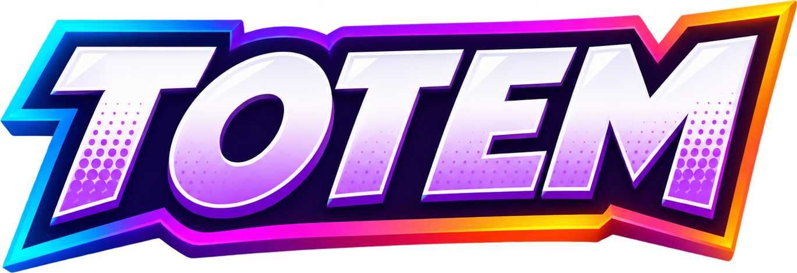
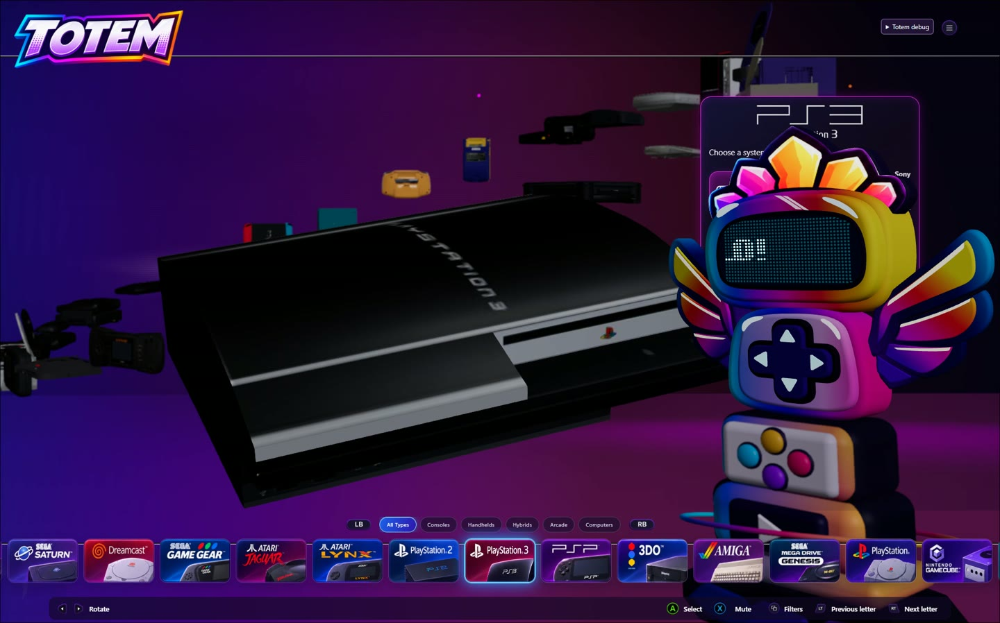
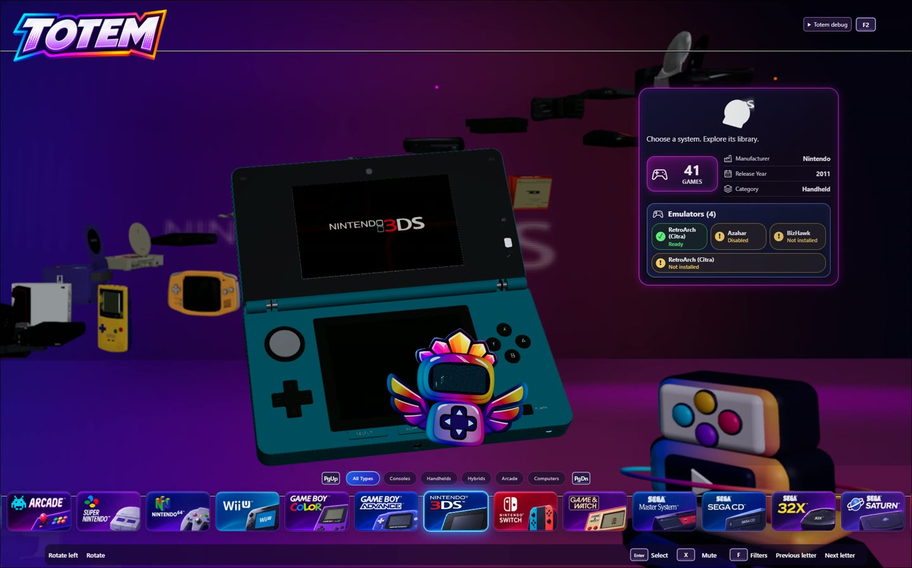

<h1 align="center">Your game shelf, in 3D.</h1>

A Windows frontend for browsing the systems you grew up with and launching the games you already own.

## What it looks like

*The current desktop development build with Tiko on his perch.*

Totem puts the hardware on a rotating shelf. The selected console moves into the foreground, its name and details appear alongside it, and the other systems recede into the background. Pick a system to move into its game chooser. With your own media configured, that scene can show a controller, a game case or cartridge, and gameplay on a virtual screen.

- **Platform Chooser:** Browse consoles, handhelds and computers using the keyboard, mouse or a controller. Detailed hardware models are included for a selection of systems; others use geometry generated by Totem.
- **Game Chooser:** Browse your indexed library and launch a selected title through an emulator you have configured.
- **Totem Studio:** Adjust the camera, lighting, object placement and interface for the two chooser scenes.

*The same carousel showing a handheld. The screenshots use a configured development library.*

## Build and run on Windows

Install Node.js 22 LTS or newer, Rust 1.89 or newer, the Microsoft C++ build tools, and WebView2. The desktop app uses `D:\Totem` as its default data root.

~~~powershell
npm ci
npm run desktop          # Build and run Totem
npm run desktop:build    # Build the Windows executable without an installer
npm run studio:desktop   # Build and run Totem Studio
~~~

When moving the built executable, keep its adjacent `assets/models` directory with it. Use **Settings** to add platform folders and configure emulators you installed separately. The public source starts with an empty game library. You can add covers and gameplay previews from your own files. Totem's private startup film and optional Tiko model are also absent from this snapshot.

## Development checks

Run `npm test` for the public source checks and `npm run build` to compile the frontend. `npm run test:legacy` also runs development checks that depend on private fixtures or workstation state, so it is not a clean clone check.

## What ships

The application bundles GLB files: hardware, controllers, a television, and blank case and cartridge templates. Hardware textures are embedded in the relevant models. ROMs, BIOS files, game covers, standalone artwork, gameplay clips and emulator binaries are outside the repository. The emulator catalogue is configuration data. The logo and screenshots above illustrate the project documentation.

See [3D model credits](public/models/CREDITS.md) for creators, sources, changes and license terms, including the notices for Open Console CAD. Each third-party asset retains its own license. Totem is an independent project and is not affiliated with the hardware or game publishers it depicts.

Totem's own code is available under the [PolyForm Noncommercial License 1.0.0](LICENSE). You can use it for hobby projects, make changes and share copies under those terms. Commercial use requires separate permission. Keep the [required notice](NOTICE) with copies. The third-party models keep their separate licenses.
